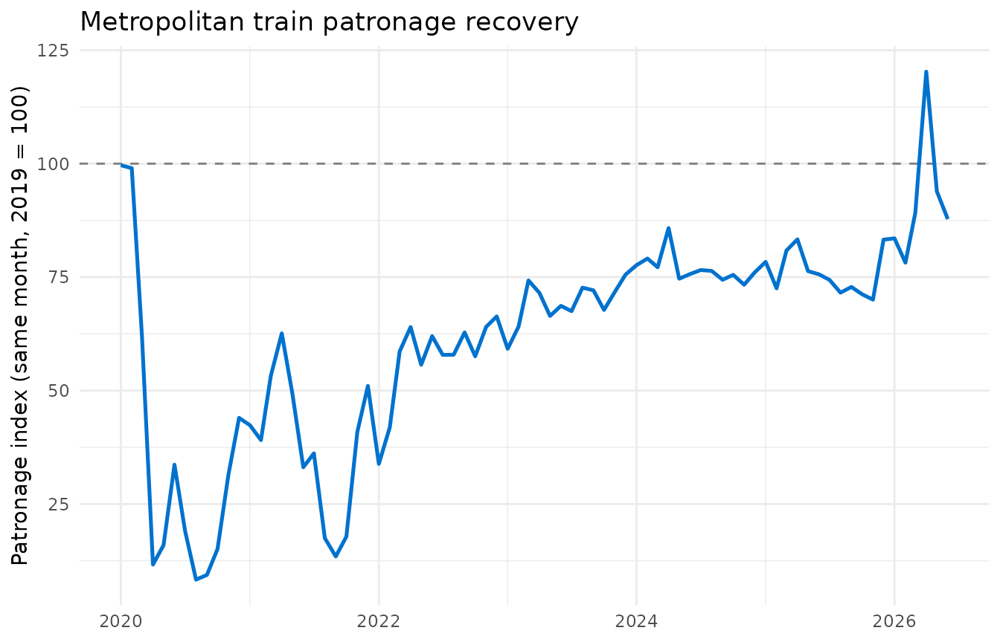

# Getting started with vicptpatronage

## Who this package is for

`vicptpatronage` is built for a **Victorian transport policy analyst or
journalist** who wants to answer a specific question: *how has each
public transport mode’s patronage recovered relative to its pre-pandemic
level, and did Victoria’s 2025-2026 free-travel and half-price fare
periods leave a lasting boost, or just a temporary bump?*

The package bundles a cleaned, tidy dataset of monthly Victorian public
transport patronage, a function for putting different modes on a
comparable recovery scale, and an interactive Shiny app for exploring
the question visually.

## Installation

`vicptpatronage` is not on CRAN. Install the development version from
GitHub:

``` r

# install.packages("remotes")
remotes::install_github("ETC5523-2026/etc5523-assignment-4-pian0dan")
```

``` r

library(vicptpatronage)
```

## The data: `monthly_patronage`

`monthly_patronage` contains monthly patron boardings for six Victorian
public transport modes (metropolitan train, tram and bus; V/Line
regional train, coach and bus), from January 2018 onward, sourced from
the Victorian Department of Transport and Planning’s Open Data portal
(CC BY 4.0).

``` r

head(monthly_patronage)
#> # A tibble: 6 × 7
#>   date        year month month_name mode               patronage fare_period 
#>   <date>     <dbl> <dbl> <chr>      <fct>                  <dbl> <fct>       
#> 1 2018-01-01  2018     1 January    Metropolitan train  16809932 Normal fares
#> 2 2018-02-01  2018     2 February   Metropolitan train  19554477 Normal fares
#> 3 2018-03-01  2018     3 March      Metropolitan train  22659010 Normal fares
#> 4 2018-04-01  2018     4 April      Metropolitan train  20312040 Normal fares
#> 5 2018-05-01  2018     5 May        Metropolitan train  22768447 Normal fares
#> 6 2018-06-01  2018     6 June       Metropolitan train  19284755 Normal fares
```

Each row is one mode in one month. The `fare_period` column flags months
substantially affected by a Victorian Government fare discount:

``` r

table(monthly_patronage$fare_period)
#> 
#>            Normal fares     Weekend free travel Free travel (every day) 
#>                     582                      12                      12 
#>        Half-price fares 
#>                       6
```

See
[`?monthly_patronage`](https://etc5523-2026.github.io/etc5523-assignment-4-pian0dan/reference/monthly_patronage.md)
for the full column reference, including how the `fare_period`
categories were derived and a data-quality fix applied to one corrupted
value in the source file.

## Comparing modes on a recovery scale: `patronage_index()`

Raw patronage isn’t directly comparable across modes with very different
volumes (metropolitan train carries millions more passengers a month
than regional coach), and it also isn’t comparable month-to-month on its
own, because patronage is strongly seasonal — Victorian public transport
use is routinely 30% higher in March than in January, even outside the
pandemic.

[`patronage_index()`](https://etc5523-2026.github.io/etc5523-assignment-4-pian0dan/reference/patronage_index.md)
addresses both problems by expressing each month’s patronage as a
percentage of the *same calendar month* in a reference year (2019, the
last full year before the pandemic, by default):

``` r

indexed <- patronage_index(monthly_patronage, reference_year = 2019)
head(indexed)
#>                   mode month       date year month_name patronage  fare_period
#> 103 Metropolitan train     1 2018-01-01 2018    January  16809932 Normal fares
#> 136 Metropolitan train     2 2018-02-01 2018   February  19554477 Normal fares
#> 145 Metropolitan train     3 2018-03-01 2018      March  22659010 Normal fares
#> 155 Metropolitan train     4 2018-04-01 2018      April  20312040 Normal fares
#> 165 Metropolitan train     5 2018-05-01 2018        May  22768447 Normal fares
#> 174 Metropolitan train     6 2018-06-01 2018       June  19284755 Normal fares
#>     baseline_patronage     index
#> 103           17074623  98.44980
#> 136           20011823  97.71462
#> 145           22250796 101.83460
#> 155           18579825 109.32310
#> 165           23045436  98.79807
#> 174           19099513 100.96988
```

An `index` of 100 means that mode, in that month, matched its 2019 level
exactly for the same month; above 100 means it has grown beyond its
pre-pandemic level; below 100 means it hasn’t yet recovered.

``` r

library(ggplot2)

indexed |>
  subset(mode == "Metropolitan train" & date >= as.Date("2020-01-01")) |>
  ggplot(aes(date, index)) +
  geom_hline(yintercept = 100, linetype = "dashed", color = "grey50") +
  geom_line(color = "#0072CE", linewidth = 0.9) +
  labs(
    x = NULL,
    y = "Patronage index (same month, 2019 = 100)",
    title = "Metropolitan train patronage recovery"
  ) +
  theme_minimal()
```



## Launching the app

The package’s Shiny app wraps this same indexing logic in an interactive
interface. Launch it with:

``` r

run_app()
```

### Using the app

- **Mode(s) to display**: tick or untick modes to compare. Each checkbox
  shows that mode’s official PTV pictogram.
- **Date range**: zoom into a specific period, such as a recovery window
  or a fare-discount period.
- **Highlight free & half-price fare periods**: shades the months
  affected by Victoria’s 2025-2026 fare discounts, at an intensity
  roughly matching how large the discount was (a pale band for
  weekend-only free travel, a medium band for half-price fares, a dark
  band for free travel every day).

### Interpreting the output

- The main chart shows each selected mode’s patronage index over time.
  Hover over (or on touch devices, tap and drag along) a line to read
  its exact index value and raw patronage count for a given month.
- The two value boxes above the chart highlight the most- and
  least-recovered mode within the selected date range, coloured to match
  that mode’s line in the chart below.
- To judge whether a fare discount left a *lasting* effect rather than a
  one-off bump, compare whether a mode’s line stays elevated after a
  shaded discount band ends, or falls back to its prior level.

### A note on limitations

The app’s indexing approach controls for seasonality and lets modes with
very different patronage volumes be compared directly, but it inherits
some real limitations worth keeping in mind:

- The “most/least recovered” ranking is based on a single latest month,
  which can still be noisy even after seasonal adjustment.
- Some fare-discount date boundaries (the extension of free travel
  through April-May 2026, and half-price fares from June 2026) are
  sourced from Victorian Government media releases rather than the
  source dataset’s own documentation, which hadn’t been updated to
  reflect them at the time this package’s data was last refreshed.
